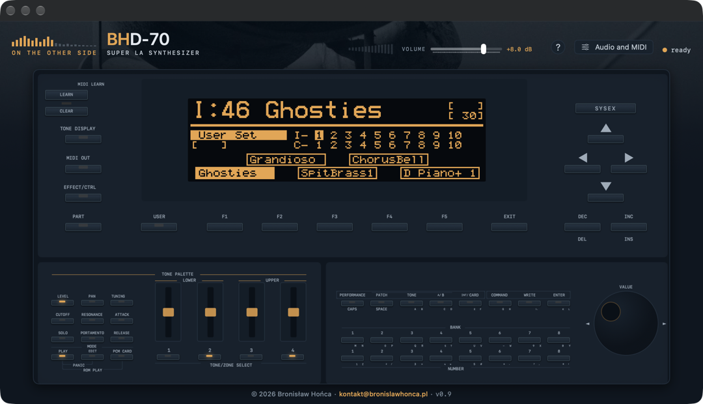

# BHD-70 — Roland D-70 Super LA Synthesizer for macOS

A careful recreation of the **Roland D-70 Super LA Synthesizer** (1990), running the
original firmware from your own unit. It works as an **AUv3 plug-in** in a DAW
(Logic Pro, Ableton Live) and as a **standalone Mac app**.

This is not a model and not an approximation: the sound is computed by the very program
that runs in the hardware, inside a modified MAME. The panel is laid out point for point
like a real D-70, and the display shows the actual pixels drawn by the firmware.

## You need your own D-70

**BHD-70 contains no Roland software and cannot contain any.** The D-70 firmware, its
wave ROMs and its factory sounds are Roland's property. This program is for people who
own a D-70: on first launch it asks for dumps taken from your own instrument, checks them
and remembers them.

| What | How many | Size each |
|---|---|---|
| firmware (EPROM IC4 + IC9) | 2 — one of versions 1.19, 1.16, 1.14, 1.12, 1.10 | 65,536 B |
| PCM waves (waverom A–F) | 6, all of them | 524,288 B |
| sounds (SysEx bulk dump) | 1 file, `.syx` or `.mid`, optional | ~69 kB |

File names do not matter — files are recognised by size and checksum. The chips are read
with an EPROM programmer; the sounds you can dump yourself over a MIDI cable and load with
the **SYSEX** button on the panel. Everything you point at stays on your computer: the
program never sends anything anywhere, and never bundles it.

Like the hardware with a flat battery, the instrument starts with **empty patch memory** —
it plays, but the patch names are garbage until you load your own sounds.

## What it does

- **30-voice polyphony, 6 multitimbral parts** (five plus percussion), as in the hardware
- the original structure: **Tone → Patch with its Tone Palette → Performance**
- **Tone Palette on four sliders** — Roland's way of reshaping a sound without entering edit mode
- full panel editing: anything you can do on a real D-70 you can do here, because it is the same software
- **TVF filter and TVA envelopes**, resonant low-pass, and the onboard reverb, chorus and flanger
- **240 × 64 pixel display** drawn by the firmware, with the original character font
- **patch memory persists** like a battery-backed instrument — what you save stays saved
- **MIDI learn**, which the hardware never had: map your controller's knobs and sliders to the panel
- the engine runs at **32 kHz** like the hardware and resamples to your device or project rate
- each plug-in instance is a separate instrument

Startup takes about **20 seconds** — that is how long the real D-70 firmware needs to boot.
It is not a fault. Offline bounce comes out silent, because the instrument runs in real time;
record the track live instead.

Requires macOS 13 (Ventura) or later, Apple Silicon or Intel.

## Download

The program is **free** and always will be.

**[Download the latest release](https://github.com/Bronislavus/BHD-70/releases/latest)** —
a signed and notarised build for macOS 13 or later, Apple Silicon and Intel. It is also on my
site, together with everything else I make: **<https://www.bronislawhonca.pl>**

This is a **beta**: it works and it plays, but every Mac, every audio interface and every D-70
is a little different. **Tell me how it goes** — what broke, what is missing, what you would
like it to do. Open an issue here, or write to **kontakt@bronislawhonca.pl**. The app has
**Help → Report a Problem or Idea…**, which opens a ready-made e-mail with your version
details; you send it yourself. The app never contacts anything online on its own.

Every message is read, and I would rather hear that something does not work than not hear
from you at all.

## Building it yourself

You need Xcode, [XcodeGen](https://github.com/yonaskolb/XcodeGen) (`brew install xcodegen`)
and the engine.

1. **Build the engine** — a MAME build with the D-70 work applied. See
   [`mame/README.md`](mame/README.md): it carries the full patch against a named
   `mamedev/mame` commit and the build command.
2. Put the resulting `d70` executable and its `lib` folder into `Zasoby/`, or clone the
   MAME tree to `~/mame-d70` (or point `MAME_D70` at it) and let the script pick it up.
3. **Build the app:** `bash build.sh` — it regenerates the Xcode project from
   `Xcode/project.yml` and installs the app, with the plug-in inside it, into
   `~/Applications`. Never edit the `.xcodeproj`; edit `project.yml`.

Signing is set to automatic, so set `DEVELOPMENT_TEAM` to your own team for a signed build.
`bash build.sh dmg` is my own release path — signing, notarisation and a DMG — and will not
work without my certificates.

`CZYTAJ.md` describes how the thing is put together, in Polish.

## Licence

The engine uses chip emulation under the **GPL-3.0**, so BHD-70 is free software under the
same licence — see [`LICENSE`](LICENSE). The source of the engine build that ships inside
the app is in [`mame/`](mame/), as the licence requires.

The photograph in `Zasoby/hero.jpg` and the application icon are mine and are not covered
by the GPL: © Bronisław Hońca, all rights reserved.

The only chip image inside the app is the display character font, 1 kB — and that one is
not Roland's: the original T6963C character ROM has never been dumped, so this is a
substitute with its own checksum.

## Thanks

- **[Sojus Records](https://github.com/sojusrecords)** — for the inspiration. They built
  the Ensoniq SD-1 32-Voice as a VST3/AU plug-in around a MAME emulation and showed that an
  instrument nobody had emulated before can be brought back this way. Musicians, not
  programmers, as they put it themselves — which is exactly how I feel about it.
- the **MAME team** and its contributors, whose work the engine stands on
- **[dsp56300/gearmulator](https://github.com/dsp56300/gearmulator)** — the custom-chip
  emulation (LP, TVF, RCC) used in the sound path, under the GPL-3.0

## Trademarks

Roland and D-70 are trademarks of Roland Corporation. BHD-70 is an independent project:
it is not made, released or endorsed by Roland, and it contains none of Roland's software.

---

Idea and concept: Bronisław Hońca, 2026 · <https://www.bronislawhonca.pl>
